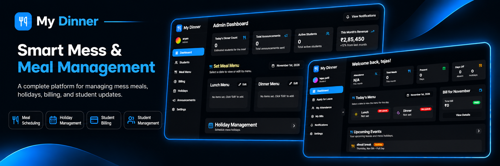
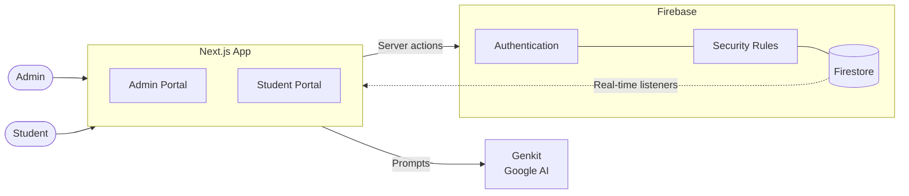
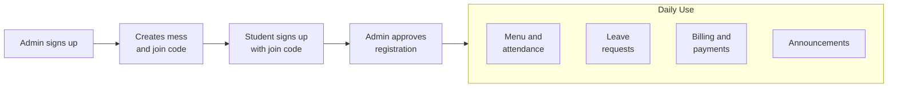

<div align="center">

# MyDinner

**A modern digital dining suite for meal coordination, attendance, and billing.**




</div>

---

## Overview

MyDinner connects mess administrators and students in one platform. Admins manage students, menus, billing, and announcements. Students track attendance, apply for leave, and view their bills. An AMOLED-inspired dark interface keeps it fast, clean, and easy to use on any device.

---

## Features

| Portal | Capabilities |
|--------|--------------|
| **Admin** | Mess registration and management, student approvals, menu scheduling, billing and payments, announcements, holiday management, analytics dashboard |
| **Student** | Dashboard overview, attendance tracking, leave requests, bill viewing, notifications, mess selection, settings |
| **AI** | Smart menu suggestions, automated notifications, predictive analytics |
| **Security** | Role-based access control, Firebase Authentication, Firestore security rules, real-time data sync |

---

## How It Works



### Mess Lifecycle



---

## Getting Started

### Prerequisites

- Node.js 18 or later
- npm or yarn
- A [Firebase](https://console.firebase.google.com/) project with Authentication and Firestore enabled
- A [Google AI Studio](https://aistudio.google.com/app/apikey) API key (for AI features)

### 1. Clone and install

```bash
git clone https://github.com/your-username/mydinner.git
cd mydinner
npm install
```

### 2. Configure environment

```bash
cp .env.example .env.local
```

Open `.env.local` and fill in:

- Your **Firebase** project configuration
- Your **Google AI** API key

### 3. Run

```bash
npm run dev
```

Open [http://localhost:3000](http://localhost:3000).

---

## Usage

| Step | Admin | Student |
|------|-------|---------|
| 1 | Sign up or log in as admin | Sign up with the mess join code |
| 2 | Create a mess and get its join code | Open the dashboard to see meals and attendance |
| 3 | Approve student registrations | Apply for leave |
| 4 | Schedule daily menus | View bills and payment status |
| 5 | Generate bills and confirm payments | Read announcements |
| 6 | Send announcements | Manage settings |

---

## Tech Stack

| Layer | Technology |
|-------|------------|
| **Framework** | [Next.js 14](https://nextjs.org/) (App Router) |
| **Language** | [TypeScript](https://www.typescriptlang.org/) |
| **Styling** | [Tailwind CSS](https://tailwindcss.com/), [shadcn/ui](https://ui.shadcn.com/) |
| **Icons & Charts** | [Lucide React](https://lucide.dev/), [Recharts](https://recharts.org/) |
| **Backend** | [Firebase](https://firebase.google.com/) (Authentication, Firestore, Security Rules, Hosting) |
| **AI** | [Genkit](https://genkit.dev/) with Google AI |
| **Tooling** | ESLint, Git |

---

## Project Structure

```
mydinner/
├── src/
│   ├── ai/                  # Genkit AI flows
│   ├── app/
│   │   ├── admin/           # Admin portal pages
│   │   ├── student/         # Student portal pages
│   │   ├── auth/            # Authentication actions
│   │   └── globals.css      # Global styles
│   ├── components/
│   │   ├── admin/           # Admin components
│   │   ├── student/         # Student components
│   │   ├── shared/          # Shared components
│   │   └── ui/              # shadcn/ui components
│   ├── contexts/            # React contexts
│   ├── hooks/               # Custom hooks
│   ├── lib/
│   │   ├── actions/         # Server actions
│   │   ├── listeners/       # Firestore listeners
│   │   └── services/        # Business logic
│   └── types/               # TypeScript types
├── docs/                    # Documentation
├── public/                  # Static assets
├── firebase.json            # Firebase config
├── firestore.rules          # Security rules
├── firestore.indexes.json   # Database indexes
├── next.config.js
├── tailwind.config.ts
└── tsconfig.json
```

---

## License

Released under the [MIT License](./LICENSE).

---

<div align="center">

**Eat Smart, Live Better.**

</div>
